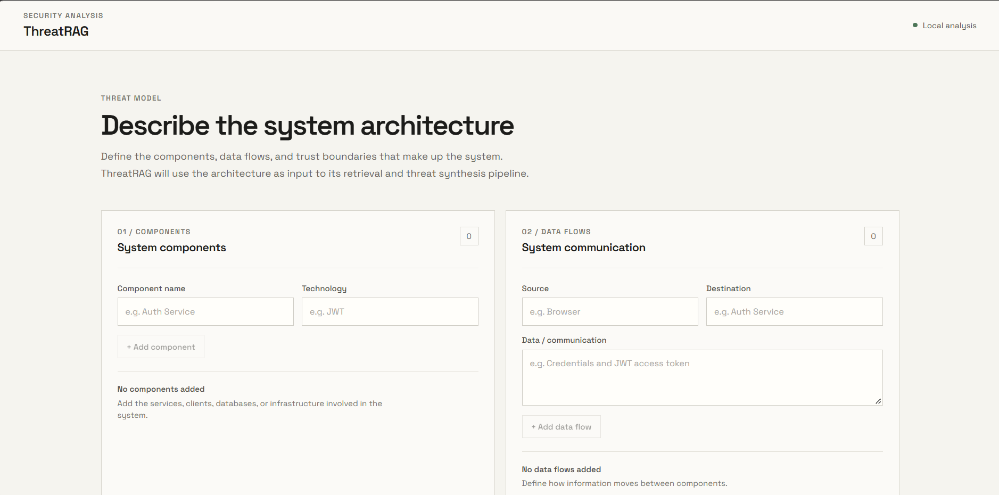
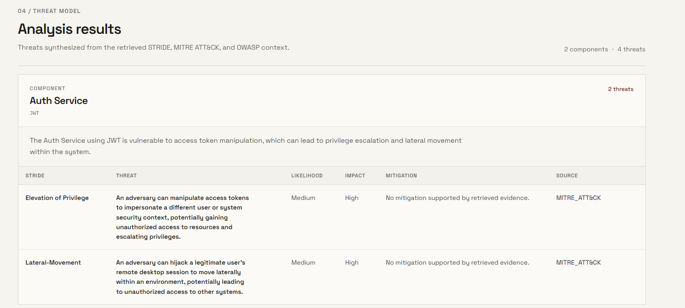

# ThreatRAG

ThreatRAG is a Retrieval-Augmented Generation (RAG) system designed to automate security threat identification and analysis. It combines hybrid retrieval, LLM-based query expansion, and reranking to retrieve relevant security knowledge and generate context-grounded threat assessments.

The system leverages security frameworks such as STRIDE, MITRE ATT&CK, and OWASP to provide structured threat analysis for different system components and technologies.

## Screenshots

### ThreatRAG Interface



### Threat Analysis Results



## Features

### Hybrid Retrieval
- Dense retrieval using Sentence Transformers and vector embeddings.
- Sparse retrieval using BM25 for keyword-based matching.
- Reciprocal Rank Fusion (RRF) to combine retrieval results.
- Cross-encoder reranking to improve the relevance of retrieved chunks.
- Deduplication and merging of results from multiple queries.

### LLM-Based Query Expansion
- Uses Ollama with Phi-4-mini for query expansion.
- Generates multiple security-focused subqueries from a system description.
- Expands queries across STRIDE, MITRE ATT&CK, and OWASP perspectives.
- Improves retrieval coverage by exploring different aspects of a security problem.

### Threat Modeling
- Accepts system components and their associated technologies.
- Retrieves relevant security knowledge from the processed knowledge base.
- Generates structured threat assessments using retrieved context.
- Identifies potential security threats and their implications.
- Produces framework-oriented threat analysis grounded in retrieved information.

### Security Knowledge Base
- Processes security knowledge into searchable chunks.
- Supports knowledge from STRIDE, MITRE ATT&CK, and OWASP.
- Combines semantic similarity with keyword matching.
- Uses PostgreSQL with pgvector for vector-based retrieval.

### REST API
- Built using FastAPI.
- Provides endpoints for health checks and threat analysis.
- Accepts structured system descriptions.
- Returns threat analysis results in JSON format.

### Web Interface
- Provides an interface for entering system components and technologies.
- Sends analysis requests to the backend API.
- Displays generated threat assessments.
- Includes loading states during analysis.

## Architecture

ThreatRAG follows a multi-stage retrieval and generation pipeline.

```text
              System Description
                       |
                       v
                Query Expansion
                 (Ollama LLM)
                       |
                       v
             Security-Focused Queries
                       |
             +---------+---------+
             |                   |
             v                   v
       Dense Retrieval      Sparse Retrieval
       (Embeddings)             (BM25)
             |                   |
             v                   v
        Vector Search       Keyword Search
       (PostgreSQL +        (BM25 Index)
          pgvector)              |
             |                   |
             +---------+---------+
                       |
                       v
          Reciprocal Rank Fusion (RRF)
                       |
                       v
                Cross-Encoder
                  Reranking
                       |
                       v
              Merge and Deduplicate
                       |
                       v
              Retrieved Context
                       |
                       v
              Threat Synthesis
                  (LLM)
                       |
                       v
             Structured Threat Model
                       |
                       v
                 REST API / UI
```

## Tech Stack

### Backend
- Python
- FastAPI
- Pydantic
- Requests

### Retrieval and NLP
- Sentence Transformers
- BAAI/bge-base-en-v1.5
- BM25 (`rank-bm25`)
- Reciprocal Rank Fusion (RRF)
- Cross-encoder reranking

### LLM
- Ollama
- Phi-4-mini (3.8B)

### Database
- PostgreSQL
- pgvector

### Infrastructure and Tools
- Docker
- Docker Compose
- Python virtual environment
- Git and GitHub

### Security Knowledge Sources
- STRIDE
- MITRE ATT&CK
- OWASP

## Retrieval Pipeline

The retrieval pipeline combines semantic search, keyword matching, and reranking to identify relevant security information.

### 1. Query Expansion

The system uses an LLM to transform a system description into multiple security-focused queries.

For example, given:

```text
Component: Auth Service
Technology: JWT
```

The query expansion stage generates queries covering different security perspectives, such as:

- Auth service JWT STRIDE threats
- Auth service JWT MITRE ATT&CK techniques
- Auth service JWT OWASP security guidance

This helps retrieve relevant information that a single query might miss.

### 2. Dense Retrieval

Dense retrieval uses Sentence Transformers to encode queries into vector embeddings.

The embeddings are used to retrieve semantically relevant security knowledge stored in PostgreSQL with pgvector.

**Embedding model:** `BAAI/bge-base-en-v1.5`

### 3. Sparse Retrieval

Sparse retrieval uses BM25 to find relevant knowledge based on keyword overlap between the query and indexed document chunks.

This complements dense retrieval by identifying documents containing important security terms, technologies, and attack techniques.

### 4. Reciprocal Rank Fusion

The results from dense and sparse retrieval are combined using Reciprocal Rank Fusion.

RRF combines rankings from multiple retrieval methods, helping the system leverage both semantic similarity and keyword relevance.

### 5. Cross-Encoder Reranking

The fused candidates are passed through a reranker to improve their ordering based on query-document relevance.

This helps prioritize the most relevant security knowledge before threat synthesis.

### 6. Context Merging

Results from multiple expanded queries are merged and deduplicated.

The system consolidates relevant chunks into a context for the final threat analysis.

### 7. Threat Synthesis

The retrieved context is passed to the LLM to generate a structured threat assessment.

The synthesis stage is designed to ground its output in retrieved security knowledge and reference the associated chunk IDs rather than inventing source references.

## Project Structure

The following illustrates the main logical components of the project. Update the paths to match your actual repository structure.

```text
ThreatRAG/
|
├── backend/
│   ├── api/
│   │   └── main.py
│   │
│   ├── retrieval/
│   │   ├── dense_retriever.py
│   │   ├── sparse_retriever.py
│   │   ├── fusion.py
│   │   └── reranker.py
│   │
│   ├── services/
│   │   ├── query_expansion.py
│   │   └── threat_synthesizer.py
│   │
│   └── requirements.txt
│
├── data/
│   ├── raw/
│   └── processed/
│       └── *_chunks.json
│
├── frontend/
│
├── docker-compose.yml
├── .env.example
└── README.md
```

*Note: This is a representative structure. Adjust directory names and filenames to reflect your actual repository.*

## Local Setup

### Prerequisites

Install the following before running the project:

- Python 3.10 or later
- Docker Desktop with Docker Compose
- Ollama
- Git

### 1. Clone the Repository

```bash
git clone https://github.com/GautamMisra/ThreatRAG.git

cd ThreatRAG
```

Replace the repository URL if your GitHub repository uses a different name.

### 2. Create